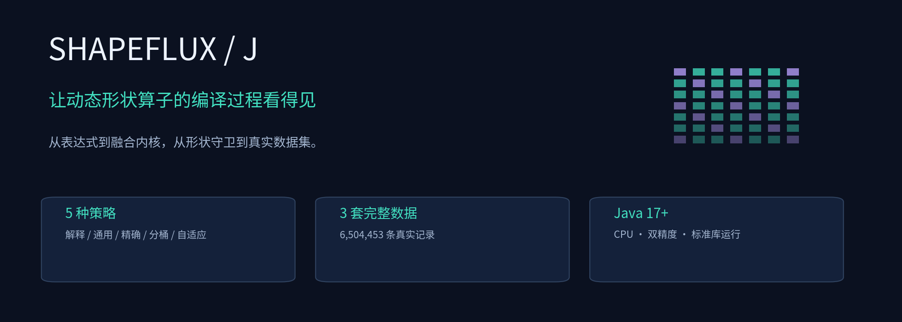
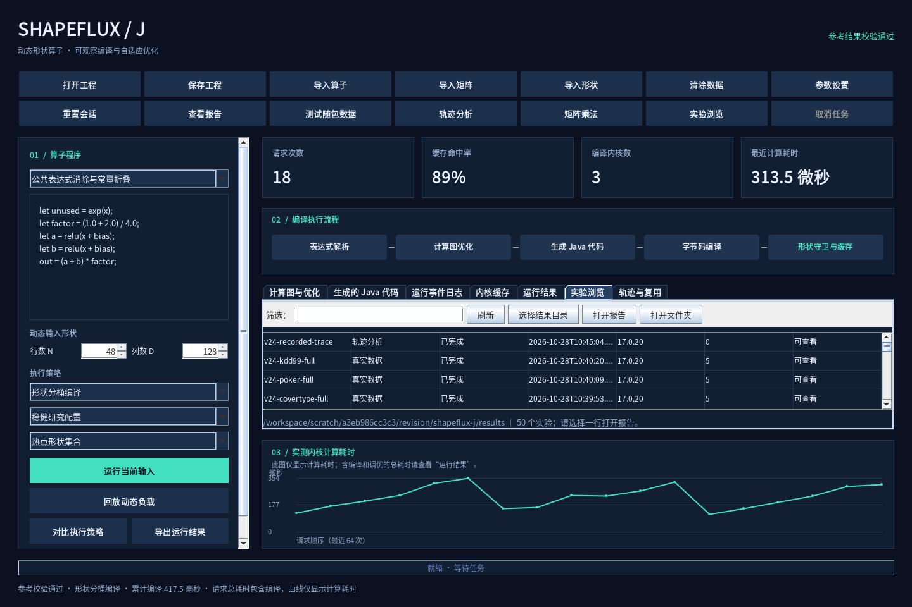
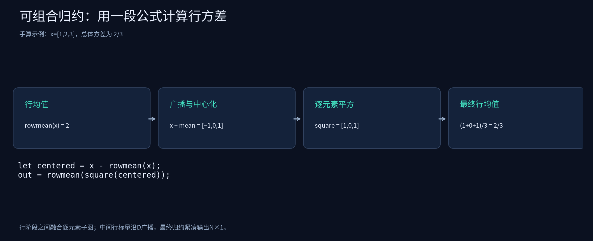
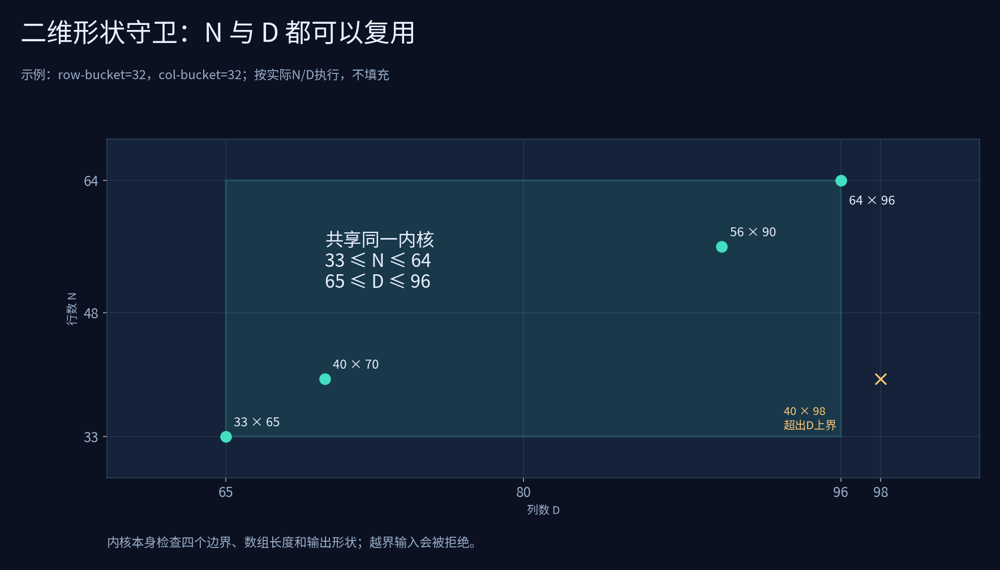
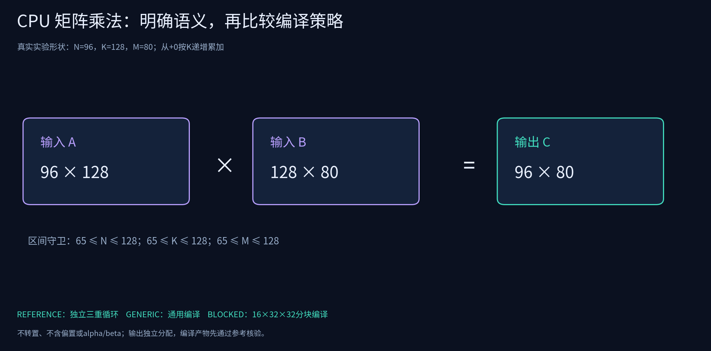
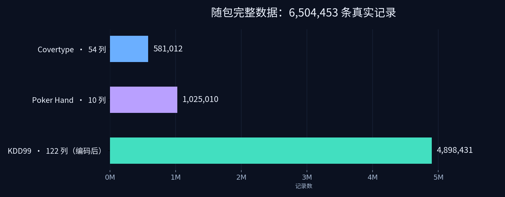
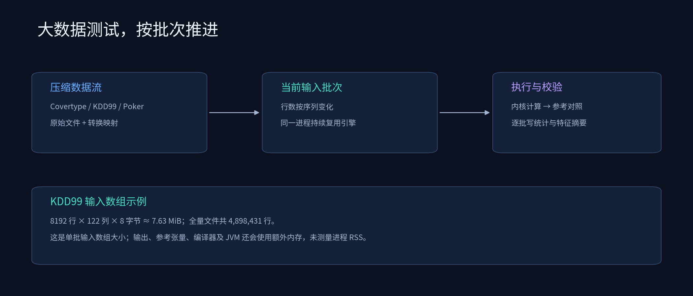

<div align="center">



# ShapeFlux-J 2.4

**从算子公式到可验证的Java内核，让编译、缓存与执行成本看得见。**

中文工作台 · 可组合归约 · 二维形状守卫 · CPU矩阵乘法 · 真实数据 · 独立重复实验

[离线阅读](README-preview.html) · [快速开始](#quick-start) · [功能与验证](FEATURES.md) · [数据集](#datasets) · [实测报告](results/index.html) · [文档地图](docs/README.md)

</div>

ShapeFlux-J使用Java标准库实现动态形状算子编译实验平台。输入公式后，可以观察解析后的计算图、优化结果、融合Java代码、字节码编译、形状派发、缓存复用和参考校验。矩阵乘法通过独立CPU编译入口提供。

**完整发行包包含三套共6,504,453条真实记录。** 运行不需要Python、数据库、前端服务或GPU。最低要求完整JDK17；你的JDK23.0.2可用于运行与构建。随包实测环境单独记录为Linux/OpenJDK17.0.20，远端CI状态以真实运行结果为准。



## 已实现的六项能力

| 从哪里开始 | 能做什么 | 会得到什么 |
|---|---|---|
| 轨迹分析 | 导入形状CSV、requests.csv或batches.csv | 频次、再次到达间隔、窗口复用估计 |
| 参数设置 | 设置N和D的区间跨度 | 守卫范围、编译次数与缓存记录 |
| 对比执行策略 | 指定独立进程重复数、预热与测量次数 | 95%置信区间、CV与系统噪声记录 |
| 可组合归约模板 | 求均值、中心化、方差或组合Softmax | 阶段化融合代码与数值核验 |
| 实验浏览 | 按目录、类型、状态和JDK筛选 | 原始数据目录与可打开的HTML报告 |
| 矩阵乘法 | 生成固定种子矩阵或导入A/B两个CSV | 参考、通用和分块CPU编译对照 |

[实现与验证入口](FEATURES.md) · [详细功能说明](docs/completed-features.md)

<a id="quick-start"></a>
## 快速开始

完整解压后，先在项目目录执行：

```bash
java -version
java -jar dist/shapeflux-j.jar doctor
java -jar dist/shapeflux-j.jar gui
```

Windows可以直接双击 **Chinese.bat**。Linux/macOS使用 `sh Chinese.sh`。`doctor`中的 `system_compiler` 应为true。

| 入口 | 用途 |
|---|---|
| `Chinese.bat` | 打开中文工作台 |
| `快速测试数据.bat` | 完整发行包中测试KDD99前65,536行、五种策略 |
| `完整测试数据.bat` | 测试KDD99全部4,898,431行 |
| `验证新版功能.bat` | 构建、运行本地检查和新增功能的命令行集成检查 |
| `开始使用.txt` | 简短中文说明 |

从Git仓库克隆时，大数据不会进入普通Git提交。仓库保留quick CSV；完整原始/处理数据使用发行附件。仅测试源码样本可以运行：

```bash
java -jar dist/shapeflux-j.jar dataset --input datasets/kdd99/prepared/quick-8192x122.csv --label none --output results/my-sample
```

## 一段公式，组合多个计算阶段

```text
let centered = x - rowmean(x);
out = rowmean(square(centered));
```

这里先求行均值，再广播回每行，最后计算总体方差。中间行归约与普通函数可以出现在let或更大的表达式中；归约根作为最终输出时使用N×1布局。

```text
let centered = x - rowmax(x);
let e = exp(centered);
out = e / rowsum(e);
```

这段代码组合了稳定Softmax：先减行最大值，再用行和归一化。生成器在行阶段之间融合逐元素子图，行内临时数组跨行复用。



## 在N和D变化时复用内核

默认按N的二次幂区间分桶并固定D。指定跨度后，可在两个轴上共享，例如 `33≤N≤64，65≤D≤96`。内核始终使用实际N和D，不补零。

```bash
java -jar dist/shapeflux-j.jar run --file examples/composable-softmax.sfx --trace examples/traces/multiaxis.csv --mode BUCKET --row-bucket 32 --col-bucket 32 --output results/my-2d
```



五种策略保留：`INTERPRETED`、`GENERIC`、`EXACT`、`BUCKET`、`ADAPTIVE`。自适应策略利用最近请求窗口中的形状族频率估计复用次数，再结合软预算、编译成本、A/B探测和周期复核作决定。候选被拒绝也是有效结果。

## 实测轨迹有出处

`examples/traces`包含从完整数据实验逐批日志提取的1163条形状记录，覆盖39种精确形状；各原始日志与轨迹都有SHA-256。它们是实际文件读取批次，不能解释成线上服务到达记录。三套运行的拼接顺序也在来源文件中明示。

```bash
java -jar dist/shapeflux-j.jar trace --input examples/traces/recorded-combined.csv --reuse-window 128 --horizon 256 --row-bucket 1024 --col-bucket 32 --output results/my-trace
```

`reuse.csv`保存逐请求窗口频次与预测，`source-trace.csv`保留原始输入，`report.html`展示形状族分布。较长轨迹可以逐批重放，输入数值用固定种子重建；这与读取真实特征值的dataset实验分开解释。

## CPU矩阵乘法，语义与代码都能检查



独立入口计算行优先 `A[N,K] × B[K,M] → C[N,M]`，提供参考三重循环、通用Java编译和16×32×32分块编译。每个输出按K递增累加，使用有限内核缓存，并验证N/K/M三轴守卫。

```bash
java -jar dist/shapeflux-j.jar matmul --rows 96 --inner 128 --cols 80 --forks 5 --warmup 4 --measure 9 --output results/my-matmul
java -jar dist/shapeflux-j.jar matmul --input-a examples/matmul-a.csv --input-b examples/matmul-b.csv --forks 2 --output results/my-matmul-csv
```

手算示例输出为 `[[58,64],[139,154]]`。矩阵乘法的源码、输出CSV、逐轮记录、计时和置信区间都保存在结果目录中。

<a id="datasets"></a>
## 三套完整真实数据



| 数据集 | 完整记录数 | 算子输入列数 | 随包内容 |
|---|---:|---:|---|
| [Covertype](datasets/covertype/README.md) | 581,012 | 54 | 原始gzip、完整CSV批次和快速样本 |
| [Poker Hand](datasets/poker/README.md) | 1,025,010 | 10 | 原始训练/测试文件、完整特征gzip和快速样本 |
| [KDD99](datasets/kdd99/README.md) | 4,898,431 | 122 | 原始完整训练文件、独热编码特征、字段映射 |
| 合计 | **6,504,453** | 按数据集固定 | 来源、许可、转换记录与摘要 |

KDD99原始41个特征中，38个数值列保留原值，3个类别字段独热编码后得到122列。项目用这些数据研究算子与编译成本，不训练分类模型。

```bash
java -jar dist/shapeflux-j.jar dataset --dataset kdd99 --max-rows 65536 --forks 5 --output results/my-kdd-repeat
java -jar dist/shapeflux-j.jar dataset --dataset kdd99 --output results/my-kdd-full
```



每种策略每次重复使用独立JVM，从文件开头读取同一特征流；每批与参考实现核验，运行前后检查源文件摘要。`-Xmx768m`是配置值；8192×122×8约7.63MiB只是最大输入数组，均不表示实际进程RSS。

## 如何判断一次实验可信

先看行数、特征数、数值校验及失败/回退计数，再看完整请求成本与计算成本。每个fork的统计量单独保留；跨fork报告Student-t 95%均值区间、样本标准差和CV。只有一个fork时不估计区间。

GC、JIT和CPU诊断覆盖工作进程执行范围，包含预热与外部参考校验；它们帮助观察波动，不证明某个事件造成了延迟变化。样本较少或分布偏斜时，区间可能很宽。


[全部实测报告](results/index.html) · [计时与统计方法](docs/benchmark-methodology.md) · [验证记录](docs/validation-report.md)

## 构建与验证

```bash
java tools/Build.java test
java -jar dist/shapeflux-j.jar verify --output results/my-verify
java -cp dist/shapeflux-j.jar tools/ValidateCompletionRelease.java results/my-feature-checks
```

完整版本使用Java17目标字节码；CI配置包含JDK17/21/23与Linux/Windows。本地验证与性能记录的JDK、系统和应用SHA均以实际文件为准。

## 源码与文档

| 路径 | 职责 |
|---|---|
| `ir` | 语法、合法算子、数值语义与图优化 |
| `compiler` | 融合/行阶段代码、内存编译、二维与三轴守卫 |
| `runtime` | 派发、窗口热度、有限缓存、探测复核与矩阵执行 |
| `experiment` | 轨迹、独立进程、统计、噪声、实时进度与报告 |
| `io` | 工程、CSV、真实数据流与预处理 |
| `ui` / `i18n` | 中文工作台、进度与可筛选实验浏览 |
| `tools` | 构建、数据准备、集成检查与打包 |

[完整文档导航](docs/README.md) · [DSL语法](docs/dsl-reference.md) · [功能与验证](FEATURES.md) · [更新记录](CHANGELOG.md)

## 许可与范围

代码使用[MIT](LICENSE)，中文后备字体使用SIL OFL1.1，三套公开数据分别保留CC BY4.0许可、引用及处理声明，详见[第三方说明](THIRD-PARTY-NOTICES.md)。

当前计算使用CPU和double；不包含GPU、自动微分、模型训练、卷积或任意秩张量。数值正确不等于分类准确率，减少编译次数也不保证所有设备、输入和冷请求下都更快。
