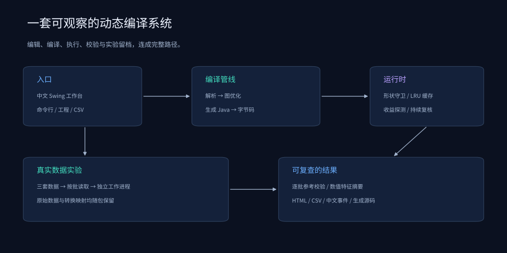

# 系统架构

[项目首页](../README.md) · [DSL](dsl-reference.md) · [方法](research-design.md)

## 前端与图优化

Parser只接受白名单表达式。节点包含逐元素算子和可组合行阶段；原始参考与优化图共享明确的数值语义。优化执行有限常量折叠、有序结构CSE和可达图筛选，不重排浮点关联，也不把维度相关归约折叠为标量。

## 两条CPU编译路径

普通图由CodeGenerator生成融合Java循环；有中间归约/归一化的图由RowCodeGenerator生成行阶段，阶段间融合逐元素子图，行内临时数组跨行复用。

矩阵乘法由MatmulCompiler生成无转置C=A×B的通用或分块代码。两个入口共享JavaSourceCompiler，在内存调用JDK编译器并加载字节码。用户不提供Java源码片段。

## 守卫、估计与缓存

ShapeGuard检查N/D范围，可精确、固定D行族或二维跨度；MatmulGuard检查N/K/M范围。生成内核直接检查边界、数组长度和工作量限制。

Engine拥有原始图、优化图、单独固定的通用内核和有上限的LRU专用缓存。ReuseWindow仅保留最近窗口的到达记录，给出形状族频率与预测；候选还要经过软预算、回收条件、实测探测和周期复核。异常有明确计数及可靠参考回退。

MatmulEngine使用有上限的验证内核缓存，按独立三重循环校验新代码。矩阵编译失败明确失败，不悄悄把异常当成编译收益。

## 数据与实验

DatasetCsv逐批读取真实CSV/gzip；Benchmark按输入形状逐批重建固定种子数值；MatmulBenchmark使用A/B快照。父进程启动独立JVM，读取原子进度，核对状态和摘要，再生成汇总、区间与噪声表。

SystemMetrics的诊断与ProgressIO的写入放在引擎计时外；数据遍历总时间仍包含批次记录和进度写入。统计不把同JVM请求伪装成独立fork。

## 中文展示与文件

Dashboard显示编译链路、实际代码、派发、缓存、进度与输出；ExperimentBrowser只读取小型元数据，支持检索和状态浏览。CSV/JSON稳定字段与中文标签分离。

工程文件兼容原有字段，并保存新的窗口与粒度参数。完整数据来源、转换、历史实验和当前版本证据分开记录；代码和完整发行文件通过源码摘要与应用摘要关联。
