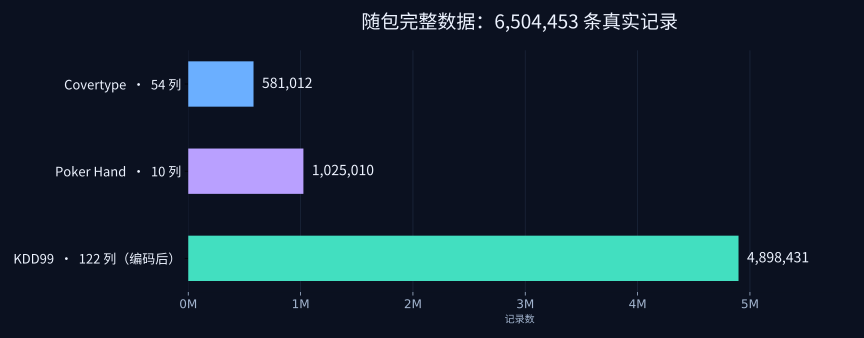

# 真实数据集地图

[返回首页](../README.md) · [操作说明](../先看这里_数据集测试说明.md) · [复现口径](benchmark-methodology.md)



项目内置三套完整公开数据，共 **6,504,453 条原始记录**。这些记录用于数值算子的输入、正确性和编译策略测试，分类标签不参与算子计算。

| 稳定 ID | 记录数 | 原始特征 | 输入特征 | Java 入口 |
|---|---:|---:|---:|---|
| `covertype` | 581,012 | 54 | 54 | `dataset --dataset covertype` |
| `poker` | 1,025,010 | 10 | 10 | `dataset --dataset poker` |
| `kdd99` | 4,898,431 | 41 | 122 | `dataset --dataset kdd99` |

## Covertype：森林覆盖变量

完整原始文件为 `datasets/covertype/covtype.data.gz`，每行54个特征和末列标签。真实数据入口读取原文件并跳过标签。`prepared/batches/` 中71个纯特征CSV完整覆盖全部记录；两个 quick 文件只是便利副本，不应在统计总量时重复加算。数值不缩放、不打乱。

[来源、版权和文件说明](../datasets/covertype/README.md)

## Poker Hand：百万条离散数值输入

原始训练文件25,010行、测试文件1,000,000行，按训练文件在前、测试文件在后的顺序合并。删除末列手牌分类标签，保留十个原始特征，输出 `datasets/poker/prepared/data.csv.gz`。此合并仅用于算子性能遍历，不进行训练/测试划分意义下的模型评估。

[来源、转换和快速样本](../datasets/poker/README.md)

## KDD99：约489万行的完整输入流

保留完整原始训练文件 `kddcup.data.gz`，实际逐行核验为 **4,898,431行**。原始41特征中的38个数值列保持原值；三列类别分别为 protocol_type、service、flag，对全量原文件建立字典并按字典序独热编码，得到 **38 + 3 + 70 + 11 = 122** 列。末列网络连接类别标签删除。


编码后文件为 `datasets/kdd99/prepared/data.csv.gz`，映射保存在 [schema.json](../datasets/kdd99/prepared/schema.json)。它是历史网络连接数据，存在大量重复与明显分布偏斜。这里用它施加真实数值流与动态批量压力，不把结果解释为现代入侵检测能力。

原始旧站下载不可用时，使用 scikit-learn 提供的全量镜像，并核对其源码公开的完整SHA-256。原始元数据取自UCI，实际来源写在 [SOURCE.json](../datasets/kdd99/SOURCE.json)。

[完整数据说明](../datasets/kdd99/README.md)

## 预处理可复现

转换工具使用Java标准库：

```bash
java -cp dist/shapeflux-j.jar tools/PrepareCovertype.java datasets/covertype/covtype.data.gz datasets/covertype/prepared-new
java -cp dist/shapeflux-j.jar tools/PrepareLargeDatasets.java
```

第二条命令针对首次准备场景，要求 `kdd99/prepared` 和 `poker/prepared` 尚不存在。交付包已完成处理，日常测试直接使用现有文件。若要重新准备，可先复制项目到独立目录，再移走那两个已有输出目录。

`preparation.json` 记录行数、列数、转换含义和摘要；`SOURCE.json` 记录原始来源与摘要。不同系统重新序列化的压缩字节可能变化，应同时核对逻辑记录、字段映射与数值流摘要。

## 使用自己的数据

`dataset --input FILE --label none|first|last` 支持纯数值CSV和gzip。无表头、无空值、不使用引号；每行列数一致，输入须为有限数值。它不会自动识别类别文本或补齐缺失值，需在导入前完成处理。
