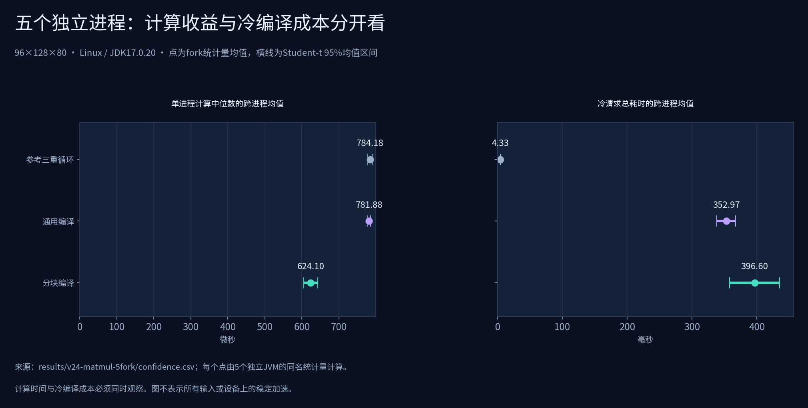

# 2.4实测与验证记录

[首页](../README.md) · [统计口径](benchmark-methodology.md) · [功能入口](../FEATURES.md)

## 环境与版本

版本2.4.0，Linux/OpenJDK17.0.20，构建目标Java17+。用户本机JDK为23.0.2。

当前JAR SHA-256：`511acf76305b1b278feab502d541116b77f3aebb8b7b23fa2956ef371d3d17a6`。下列性能实验的metadata均与此文件一致；完整证据索引见[JSON](../results/v24-evidence.json)。

## 本地与发布检查

| 检查 | 通过数 | 证据 |
|---|---:|---|
| 本地行为、编译、文件、中文与数值测试 | 679 | [日志](../results/v24-unit-tests.log) |
| JAR内置算子/形状自检 | 220 | [验证JSON](../results/v24-release-checks/verify/verification.json) |
| 通用发布集成检查 | 19 | [检查JSON](../results/v24-release-checks/checks.json) |
| 真实数据发布集成检查 | 13 | [检查JSON](../results/v24-dataset-checks/checks.json) |
| 2.4功能发布集成检查 | 23 | [检查JSON](../results/v24-completion-checks/checks.json) |

新检查覆盖手算行方差、组合Softmax、常量归约依赖D、二维守卫四边界与缓存复用、滑动窗口过期、配置兼容、矩阵乘法余数块和三轴守卫、NaN/无穷、别名限制、t区间、实际进度、可移植报告链接、错误参数和取消状态。

## 五次独立进程实验

| 实验 | 进程数 | 输入/测量 | 结果 |
|---|---:|---|---|
| [CPU矩阵乘法](../results/v24-matmul-5fork/report.html) | 15 | 96×128×80，3种模式×5fork | 全部通过，最大误差0 |
| [组合归约与二维守卫](../results/v24-composed-5fork/report.html) | 25 | 5种策略×5fork，跨N/D轨迹 | 全部通过，最大误差0 |
| [KDD99快速重复](../results/v24-kdd99-quick-5fork/report.html) | 25 | 每进程65,536行，5种策略×5fork | 全部通过，最大误差0 |
| [实测形状重放](../results/v24-recorded-5fork/report.html) | 15 | Poker批次形状，3种策略×5fork | 全部通过，最大误差0 |

80个独立进程全部保存原始输出、应用摘要、置信区间和噪声记录。矩阵手算命令另有6个独立进程验证 `[[58,64],[139,154]]`。一组实验中同JVM请求没有被计为独立fork。

该形状下分块计算中位数的跨fork均值约624.099微秒，参考约784.178微秒；同时分块冷请求均值约396.599毫秒，参考约4.332毫秒。图表同时展示收益与编译成本，不能只取较有利的指标。某些冷请求或P95的CV较高，原始记录全部保留，未作因果归因。

## 三套完整数据回归

| 数据集 | 每策略真实行数 | 输入列 | 策略进程数 | 报告 |
|---|---:|---:|---:|---|
| Covertype | 581,012 | 54 | 5 | [完整报告](../results/v24-covertype-full/report.html) |
| Poker Hand | 1,025,010 | 10 | 5 | [完整报告](../results/v24-poker-full/report.html) |
| KDD99 | 4,898,431 | 122 | 5 | [完整报告](../results/v24-kdd99-full/report.html) |

共15个独立进程、32,522,265行次、5,815批次核验。全部数值正确，最大绝对误差0，编译失败、运行失败与回退均为0。行次包含五种策略重复读取，不表示有3252万条不同记录。

全量回归每策略只有1fork，用于覆盖完整数据与正确性，不估计跨进程方差；五fork证据在上表的重复实验中。原始数据转换审计沿用[独立逐行审计](../results/v23-data-audit.json)，输入数据未改变；新代码已完整重跑，不用旧版结果代替当前回归。

## 状态和历史

发布检查中有刻意构造的失败、超时和取消，正确行为是FAILED/CANCELLED且不生成完整报告。这些目录用于负向测试，不是被隐藏的性能失败。

[2.3历史记录](history/validation-v23.md)与[2.2历史记录](history/validation-v22.md)保留当时版本、摘要与口径。不同版本不作因果加速比较。远端CI状态以仓库真实执行结果为准；当前文档只引用实际保存的本地证据。
