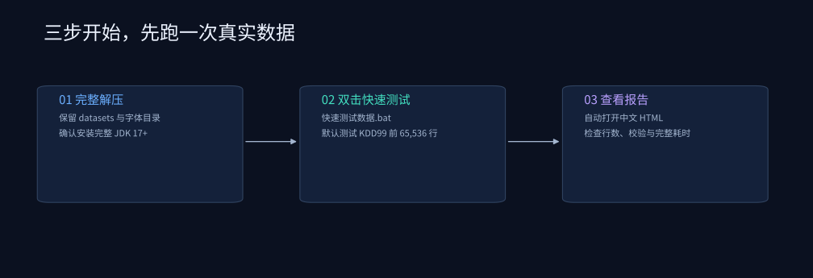
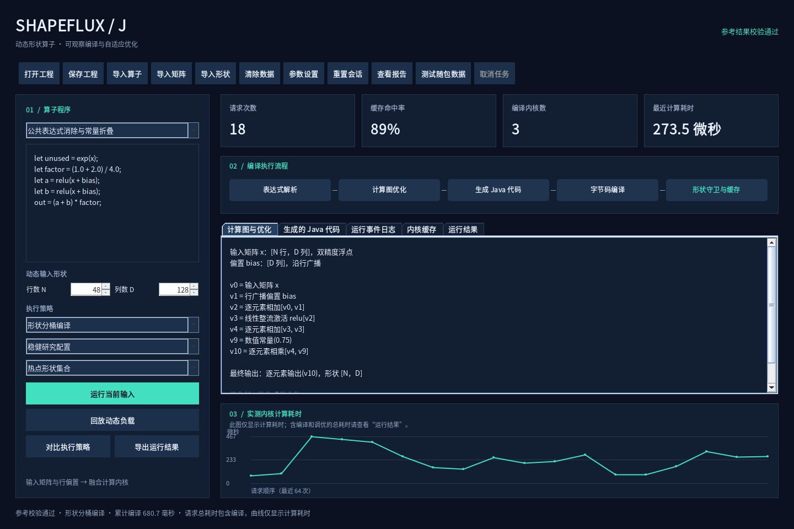
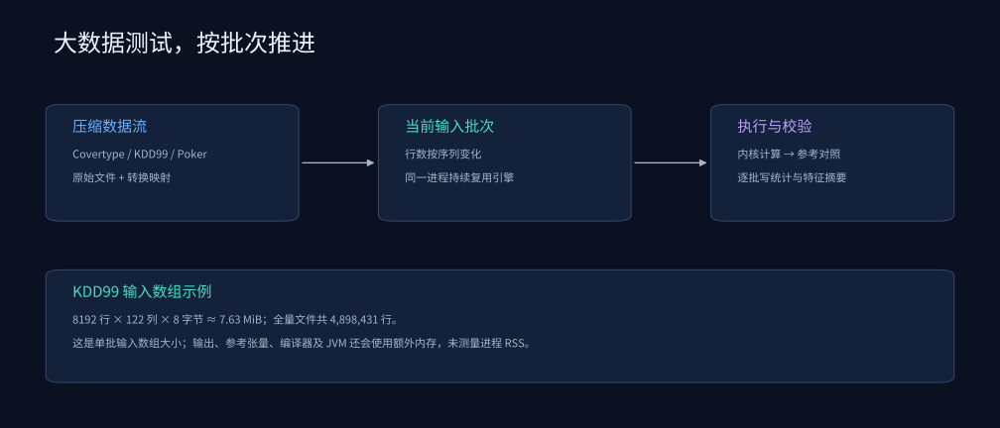

# 从双击启动，到跑完650万条真实数据

[项目首页](README.md) · [按钮说明](docs/user-guide.md) · [数据集地图](docs/datasets.md) · [常见问题](docs/faq.md)



本包包含中文版Java项目、三套完整数据、快速CSV样本、原始数据来源和已有实测报告。**运行不需要Python、Maven、数据库或再次下载数据。** 请安装完整JDK 17或更新版本，并完整解压。

## 1. 第一次使用：双击快速测试

1. 进入解压后的 `shapeflux-j` 文件夹。
2. 双击 **`快速测试数据.bat`**。
3. 它默认读取 **KDD99前65,536行、122列编码后特征**，用均方根归一化公式依次测试五种策略。
4. 等待控制台提示完成；脚本会自动打开中文HTML报告。
5. 结果保存在控制台打印的 `results/dataset-kdd99-65536-随机编号` 目录。

Windows快捷脚本：

| 文件 | 用途 |
|---|---|
| `Chinese.bat` | 打开中文工作台 |
| `快速测试数据.bat` | KDD99前65,536行，五种策略 |
| `完整测试数据.bat` | KDD99全部4,898,431行，五种策略 |
| `test-dataset.bat` | 底层脚本，可指定行数与数据集ID |
| `开始使用.txt` | 简短操作说明 |

**完整测试会依次运行多个工作进程，所需时间与CPU、磁盘和JDK有关。** 第一次先跑快速测试，再使用完整入口。每次创建新的结果目录，不覆盖已有实验。

## 2. 用图形界面选择数据集



1. 双击 **`Chinese.bat`**。
2. 左侧选择 **“均方根归一化（RMSNorm）”**，配置先保留 **“稳健研究配置”**。
3. 点击顶部 **“测试随包数据”**。
4. 在数据集选择框里选择 Covertype、KDD99 或 Poker Hand。
5. 选择“快速测试（前65,536行）”或“完整测试”。
6. 完成后界面自动切到“运行结果”，点击 **“查看报告”** 打开详细表格。

该入口使用当前编辑区公式和当前引擎参数，自动比较全部五种策略；N/D输入框、合成负载选择和先前导入的单个矩阵不参与这项测试。点击“取消任务”会结束当前工作进程，保留已完成记录并标记取消状态。

## 3. 只导入一小批，观察公式如何变成代码

| 可直接导入的CSV | 行数 × 特征数 |
|---|---:|
| `datasets/covertype/prepared/quick-1024x54.csv` | 1024 × 54 |
| `datasets/covertype/prepared/quick-8192x54.csv` | 8192 × 54 |
| `datasets/poker/prepared/quick-8192x10.csv` | 8192 × 10 |
| `datasets/kdd99/prepared/quick-8192x122.csv` | 8192 × 122 |

选择算子后点击“导入矩阵”，选择其中一个CSV，询问偏置时选“否”。选择“通用融合编译”，点击“运行当前输入”。随后查看“计算图与优化”“生成的Java代码”“运行事件日志”和“内核缓存”。

点击“导出运行结果”，选择文件夹，打开导出目录中的 `运行报告.txt`。Covertype的 `prepared/batches` 下71个CSV也都可导入；`prepared/batches.csv` 是文件清单，不是矩阵。

## 4. 三个按钮的输入不同

| 操作 | 数据来源 | 适合观察 |
|---|---|---|
| 运行当前输入 | 已导入矩阵；未导入时生成固定种子矩阵 | 单次公式、生成代码、会话缓存 |
| 回放动态负载 / 对比执行策略 | 按形状轨迹生成的固定种子数值 | 可控形状序列与策略差异 |
| 测试随包数据 | 所选完整数据集的真实特征流 | 大规模数据遍历与跨批缓存复用 |

## 5. 在报告里先看这几项



先检查“实际行数”“特征数”“校验”。完整遍历时，每种策略应处理：

| 数据集 | 实际行数 | 输入特征 |
|---|---:|---:|
| Covertype | 581,012 | 54 |
| Poker Hand | 1,025,010 | 10 |
| KDD99 | 4,898,431 | 122 |

然后比较引擎总耗时、内核计算耗时、编译次数和缓存命中率。完整遍历包含冷编译请求；输入读取与外部参考校验单独记录。不要把数值一致性校验理解成分类准确率。详细定义见 [计时方法](docs/benchmark-methodology.md)。

结果目录中：`report.html` 是中文总表，`概览.txt` 是中文文本，`summary.csv` 是策略原始统计。各策略目录的 `batches.csv` 是逐批数据，`运行事件.txt` 解释派发与缓存过程，`generated` 保存最终缓存内核源码。

## 6. 命令行与Linux/macOS

```bash
# 打开中文界面
sh Chinese.sh

# 快速测试KDD99
sh test-dataset.sh 65536 kdd99

# 完整测试Poker Hand
sh test-dataset.sh 0 poker

# Covertype完整数据，三次独立重复
java -jar dist/shapeflux-j.jar dataset --dataset covertype --forks 3 --output results/my-cov

# KDD99仅测试两种策略
java -jar dist/shapeflux-j.jar dataset --dataset kdd99 --modes GENERIC,BUCKET --output results/my-kdd-two
```

Windows命令提示符可用 `test-dataset.bat 65536 poker` 或 `test-dataset.bat 0 covertype`。数据集ID为 `covertype`、`kdd99`、`poker`。`--max-rows 0` 表示全量；批次行数序列可通过 `--batches` 指定。

## 7. 自己下载的更大数据

```bash
java -jar dist/shapeflux-j.jar dataset --input datasets/HIGGS.csv.gz --label first --max-rows 65536 --output results/my-higgs
```

SUSY和HIGGS的官方全量文件未包含在本包，可从官方页面下载后使用首列标签设置：

- https://archive.ics.uci.edu/dataset/279/susy
- https://archive.ics.uci.edu/dataset/280/higgs

`--label none` 表示纯特征，`first` 表示首列标签，`last` 表示末列标签。自定义CSV/gzip需先处理好类别、缺失值和表头；单批最多800万元素。`--dataset` 与 `--input` 择一使用。

## 8. 文件名已经统一

中文界面入口是 `Chinese.bat` / `Chinese.sh`；快速和完整测试入口是 `快速测试数据.bat` / `完整测试数据.bat`。README、操作文档和脚本引用均使用这些文件名。请使用新包完整解压后的入口，避免误开旧目录。
